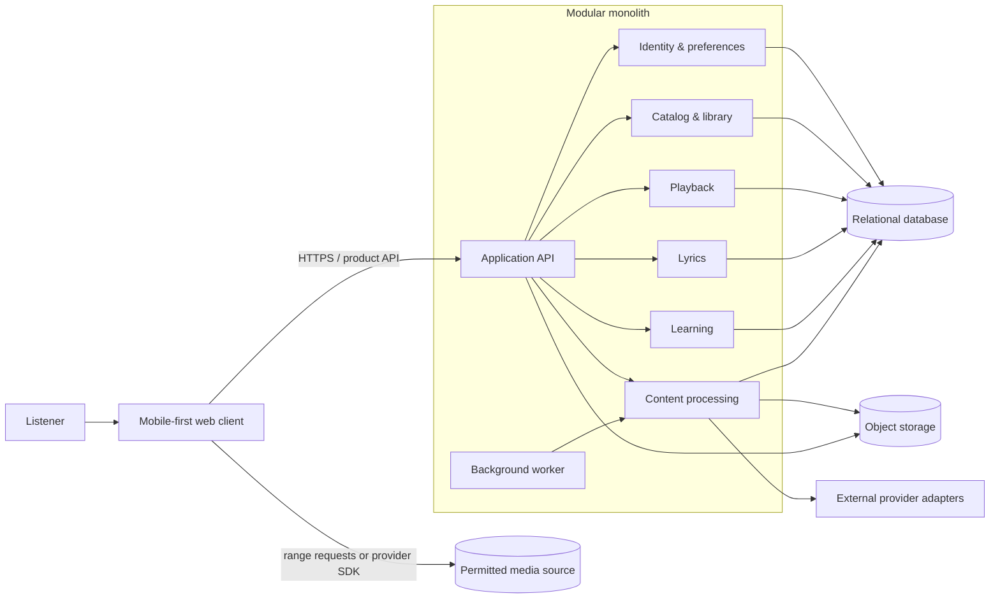

# UtaStream Initial Architecture

**Status:** Working proposal  
**Last updated:** 2026-10-19  
**Governing decision:** [ADR-0002](../adrs/0002-start-with-a-modular-monolith-and-vertical-slices.md)

This document turns the current product flow into an initial system map. It is
deliberately one level less permanent than an ADR: names and boundaries should
change as the walking skeleton teaches us more.

## Product capabilities inferred from the prototype

| Product surface | Required capability | First-slice boundary |
| --- | --- | --- |
| Home, collection, and search | Catalog and library | Begin with seeded content; search and ingestion can follow. |
| Now Playing and mini-player | Playback | Browser playback with a server-resolved permitted source. |
| Synchronized lyric preview and full-screen lyrics | Lyrics | Versioned timed segments for one seeded song. |
| Translation, furigana, grammar, and replay | Lyrics + learning | Fixture-backed annotations first; retain source and version. |
| Save to deck and return to listening | Learning | Persist a contextual save without changing playback state. |
| Deck and review overview | Learning | Show saved items; scheduling is a later slice. |
| Profile hub and preferences | Identity and preferences | Local defaults first, server persistence when accounts arrive. |
| User-provided content | Catalog + processing | Design the job boundary now; defer broad ingestion until rights and threat models are decided. |

## Runtime view



Media delivery is shown separately from the application API because audio
bytes should not normally pass through ordinary JSON request handlers. The
eventual implementation may use signed object-storage URLs or a licensed
provider SDK. That choice requires a rights and media-source ADR.

## First walking skeleton

The first executable slice should prove one coherent outcome:

```text
Open seeded collection
  -> choose a permitted track
  -> begin playback
  -> display synchronized lyrics
  -> select one expression
  -> view a fixture-backed explanation
  -> save it
  -> dismiss the explanation
  -> continue at the same playback position
```

It should include real module and API boundaries, persistence for the save,
and an automated browser-level happy-path test. It does not need authentication,
open-ended music ingestion, generated explanations, spaced repetition, or a
production cloud environment.

## State ownership

| State | Initial owner | Notes |
| --- | --- | --- |
| Audio element, current time, play/pause, transient queue | Web client | Must survive opening and closing lyric-learning surfaces. |
| Track and collection metadata | Catalog module | Stable UtaStream IDs; retain content source. |
| Playable source resolution | Playback module | Returns authorized, short-lived playback information. |
| Lyric text, timing, readings, and translations | Lyrics module | Version the document and its derived annotations. |
| Selected lyric and open panels | Web client | Ephemeral UI state, not a server concern. |
| Saved expression and source context | Learning module | Reference lyric document and segment versions. |
| Import and enrichment progress | Processing module | Persistent, observable, retryable job state. |

## Boundary rules

1. UI components do not call storage or language providers directly.
2. Domain modules do not import another module's internal repositories.
3. Provider adapters translate to UtaStream-owned types at the boundary.
4. Processing results become visible atomically only after validation.
5. Content records carry source, rights/permission facts, and derivation
   metadata appropriate to their type.
6. Deleting source content must make its derived artifacts discoverable for
   deletion; this should be tested before user uploads are enabled.
7. Playback continuity is an explicit cross-screen invariant.

## Suggested build order

| Increment | Outcome | Decisions required first |
| --- | --- | --- |
| 1. Repository foundation | Client, API, worker, database, tests, and local run command exist. | Stack and package/repository layout ADR. |
| 2. Seeded listening | One legal fixture track plays from collection to Now Playing. | Media fixture and playback approach. |
| 3. Timed lyrics | Lyrics follow playback and expand without losing position. | Lyric document and timing contract. |
| 4. Contextual save | An expression can be explained and saved in context. | Learning-record identity and provenance. |
| 5. Processing skeleton | A fixture job progresses, retries safely, and publishes a versioned result. | Queue/job implementation choice. |
| 6. Accounts and sync | Preferences, library, and saves persist per user. | Authentication and privacy ADR. |
| 7. User content experiment | One tightly scoped import route is validated. | Rights, retention, security, and source-specific ADRs. |

## Next ADR candidates

Write these only as their decisions become necessary:

1. **Application stack and repository layout** — client framework, server
   runtime, package manager, contract strategy, and test layers.
2. **Media-source and rights boundary** — what content the prototype may play,
   whether uploads or provider links are allowed, retention, and deletion.
3. **Lyric document and timing model** — line/word granularity, versions,
   readings, translations, and attribution.
4. **Background job mechanism** — database-backed jobs versus a dedicated
   broker, plus retry and idempotency policy.
5. **Authentication and privacy baseline** — account boundary, sensitive data,
   analytics, and retention.
6. **Explanation provenance** — dictionaries, translation or model providers,
   confidence, review, and how generated content is labeled.

## Questions to answer before accepting ADR-0002

- Is the first deliverable a responsive web application, or is a native mobile
  client already a firm requirement?
- Is a seeded, redistributable track acceptable for the walking skeleton?
- Should the first backend be optimized for one-person local development or
  for an already selected hosting platform?
- Which capability is the highest-risk experiment: playback, lyric timing,
  content acquisition, or explanation quality?
