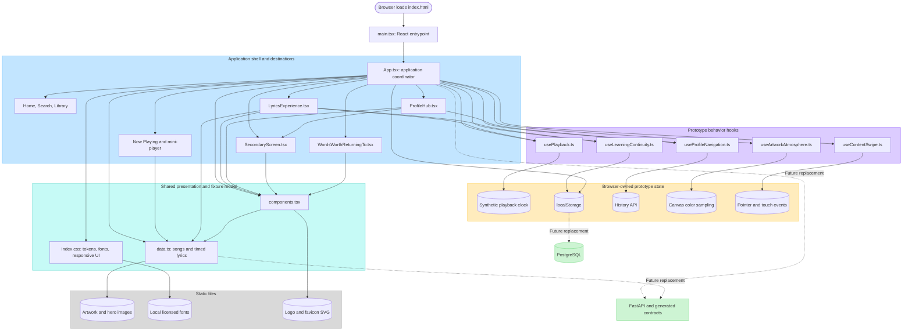

# Figma Make prototype map

This diagram describes the snapshot in
`prototypes/figma-make/utastream-2026-10-27/UtaStream music learning prototype (Copy)`.
It shows source dependencies and runtime ownership; it is not the target
production architecture.

## How to read it

- `App.tsx` is the prototype's composition root. It coordinates destinations,
  overlays, the current song, favorites, saved expressions, review state,
  preferences, accessibility flags, and dialogs.
- The screen components are mostly presentation layers receiving state and
  callbacks from `App.tsx`; they are not independently routed pages.
- The custom hooks isolate useful interaction experiments, but they still
  operate entirely in the browser.
- `usePlayback.ts` advances a synthetic clock and derives the active lyric from
  fixture timing. It is not yet a real media adapter.
- `data.ts` is both the catalog fixture and lyric-document fixture. Production
  code should replace these imports with application-owned view models backed
  by the API contract.
- `localStorage` currently stands in for user preferences, favorites, saved
  learning items, custom decks, and learning continuity. PostgreSQL will own
  the authoritative persisted records in the walking skeleton.
- The dotted green path marks the main production migration seam rather than
  an existing runtime dependency.

